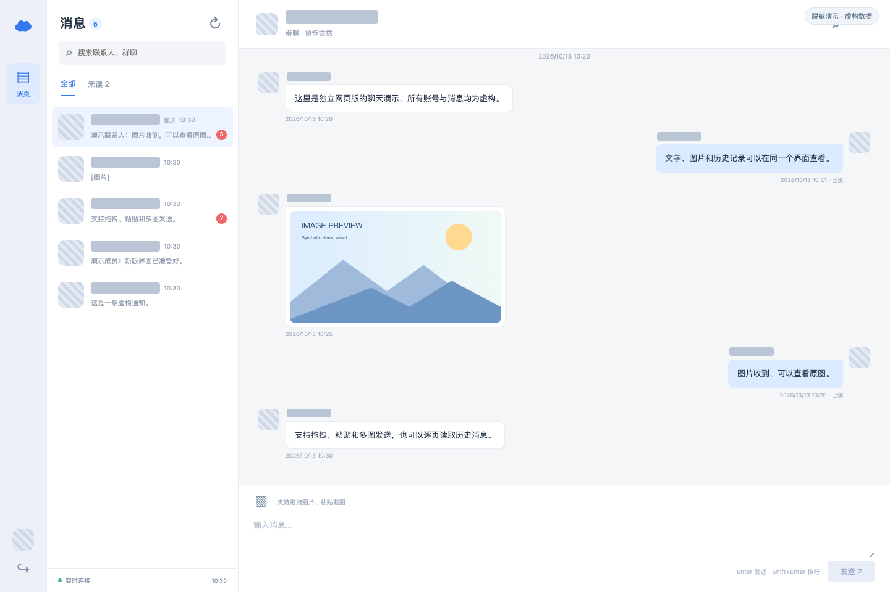
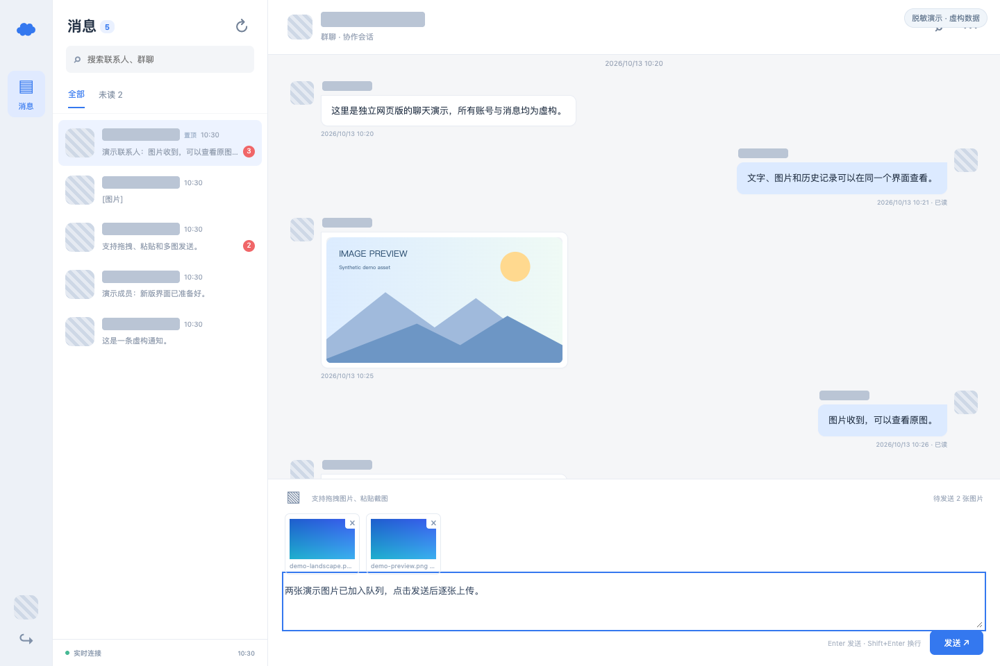
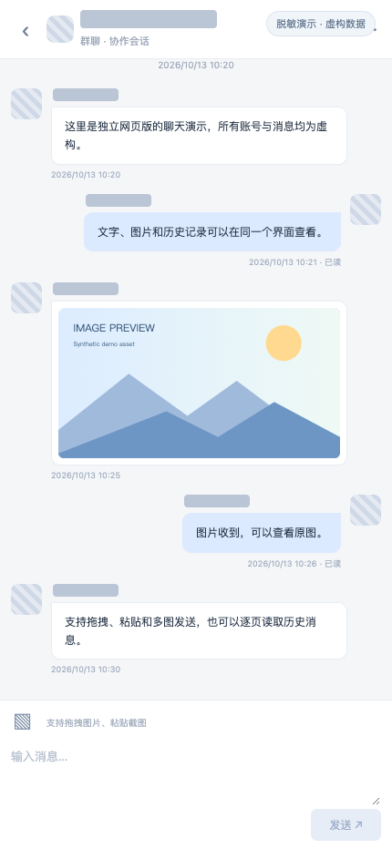

# 云之家独立网页版聊天客户端

使用个人云之家账号，在浏览器中查看联系人和群聊、读取消息记录，并发送文字与图片。项目由本机 Python 服务和原生 JavaScript 页面组成，运行时不依赖云之家桌面客户端，也不需要安装 Python 第三方依赖。

这是独立的非官方项目，与云之家及其运营方没有隶属关系。使用当前官方网页版内部接口，协议兼容性可能随上游更新变化。项目面向本机单用户使用，不支持直接部署为公网或多租户服务。

## 功能

- **聊天列表**：分页读取内部、外部会话，显示头像、最新消息摘要、时间、未读数、@ 提醒、置顶和免打扰状态；支持联系人与群组搜索。
- **实时同步**：上游 WebSocket 通知触发增量读取，本机 SSE 推送到浏览器；断线自动重连，并通过轮询补拉消息。
- **对话记录**：最近消息和向前分页、去重、撤回提示、已读状态、加载历史时保持位置；搜索当前已加载的消息。
- **消息展示**：文字、默认表情、富文本、图片/GIF、文件、语音、视频、引用和常见业务卡片；支持原图预览与下载。
- **消息发送**：文字、选择图片、粘贴图片、拖放图片和多图队列；仅在取得服务端 `msgId` 后显示发送成功。
- **阅读与编辑**：按会话保存文字草稿、新消息提示、会话成员资料和窄屏布局。

## 界面预览

以下截图来自项目实际界面，使用虚构账号、消息和示例图片。姓名、群名和头像区域已遮挡，不包含真实登录二维码、账号 ID 或聊天记录。

**桌面聊天：会话列表、未读提示、文字消息与图片展示。**



**图片发送：多图预览队列与文字编辑。**



**窄屏布局：对话记录与图片预览。**



截图生成与脱敏方式见 [预览图说明](docs/images/README.md)。

## 快速开始

### 环境要求

- Python **3.9 或更高版本**，使用标准库即可运行。
- 支持 JavaScript 模块、EventSource 和 sessionStorage 的现代浏览器。
- 已有个人云之家账号，以及可扫码登录的云之家手机 App。
- 本机网络能够访问云之家 HTTPS 和 WebSocket 服务。
- Node.js **18 或更高版本**仅用于前端离线测试，运行应用不需要 Node.js。

下载或克隆源码，进入项目根目录后启动：

```sh
python3 server.py
```

Windows 可使用 `py -3 server.py`。macOS 也可双击 `start.command` 或运行 `./start.command`；该脚本会尝试读取系统 HTTPS 代理配置。

打开 [本机聊天页面](http://127.0.0.1:8765)，点击“获取登录二维码”，用云之家手机 App 扫码并确认。登录后选择会话或搜索联系人，查看消息或发送文字、图片。

终端按 `Ctrl+C` 停止服务。重启服务后需要重新扫码登录。

### 配置

配置通过启动进程的环境变量传入；项目不会自动读取 `.env` 文件。

| 变量 | 默认值 | 说明 |
| --- | --- | --- |
| `PORT` | `8765` | 本机 HTTP 端口；监听地址固定为 `127.0.0.1` |
| `YZJ_PROXY` | 空 | HTTPS 请求及 WebSocket 的 HTTP CONNECT 代理，例如 `http://127.0.0.1:7890`；端口需按本机配置修改 |

macOS / Linux 示例：

```sh
PORT=8766 python3 server.py
YZJ_PROXY=http://127.0.0.1:7890 python3 server.py
```

PowerShell 示例：

```powershell
$env:PORT = "8766"
py -3 server.py
```

修改端口后访问对应的 `http://127.0.0.1:<端口>`。直接启动 `server.py` 不会自动继承 macOS 系统代理，需显式设置 `YZJ_PROXY`。

## 图片发送机制

图片先上传到云之家文件服务取得 `fileId`，再通过附件消息 `msgType=8` 引用该文件。`param.ftype` 区分图片、GIF 和普通文件。完整字段与认证链路见 [消息发送实现说明](docs/message-implementation.md)。

| 情况 | 当前行为 |
| --- | --- |
| PNG、JPEG、GIF、BMP | 读取真实文件格式和尺寸，保留原始字节，不压缩或转换 |
| 单张图片超过 32 MiB | 拒绝上传 |
| GIF | 按 GIF/表情附件发送 |
| 其他图片达到 8 MiB，或任一边达到 5000 像素 | 按普通文件附件发送，界面提前提示 |
| 文字与多张图片 | 按顺序作为独立消息发送，不合并为混排富文本 |
| 上传或已知发送失败 | 保留失败项；已确认成功的图片移出队列 |
| 请求超时、回执缺失 | 标记结果不确定，阻止自动重发，允许核对近期消息 |

8 MiB / 5000 像素的分流规则来自桌面端观察，是本项目采用的保守设计；并非宣称当前官方网页或所有账号具有相同限制。核对最近 100 条消息未找到匹配记录不能证明发送失败，应在云之家确认后再决定是否重新发送。

## 数据与使用边界

- 登录 Cookie、二维码 token、会话缓存和发送回执保存在服务内存中，不主动写入磁盘或请求日志。退出登录会清理这些会话状态。
- 浏览器使用 HttpOnly、SameSite=Strict 的本机会话 Cookie。文字草稿存于当前标签页的 `sessionStorage`，包含草稿内容和目标信息；退出登录清理草稿。浏览器会话恢复行为由浏览器决定。
- 图片发送队列不持久化；用户主动下载的文件会进入浏览器的下载位置。开发者自行录制的截图、HAR、日志和抓包文件可能包含私人消息或登录凭据。
- 本机服务验证 Host 与写请求 Origin，上游连接校验 HTTPS 证书；媒体只转发来自已读取消息的受限云之家地址。
- 默认表情从云之家公开 CDN 加载；原图、文件、卡片链接等依赖上游资源是否仍可访问。
- 特殊业务卡片主要提供内容展示与打开链接，不实现审批或提交动作。语音、视频播放还取决于浏览器编码支持。
- 发送回执去重记录只在当前服务进程内有效，不提供跨重启的持久幂等保证。不要将当前服务经端口转发、共享代理等方式暴露到公网。

## 项目结构

```text
.
├── server.py                  # 本机 HTTP 服务、内存会话、静态页面
├── api.py                     # 扫码登录、目标查询、上传与发送回执
├── chat.py                    # 会话、消息记录、媒体、成员与卡片
├── live.py                    # 上游 WebSocket 与本机 SSE
├── start.command              # macOS 启动入口
├── web/                       # 聊天页面、样式、表情映射与纯逻辑
├── tests/                     # 离线测试与人工生成的图片夹具
├── docs/                      # 实现说明与公开源码检查说明
└── LICENSE                    # MIT 许可证
```

协议与展示逻辑见 [聊天实现说明](docs/chat-implementation.md)。原始客户端安装包、提取源码、账号截图、登录响应和抓包不属于公开源码，均排除在版本管理之外。

## 开发与验证

在项目根目录执行：

```sh
python3 -m unittest discover -s tests -v
python3 -m py_compile server.py api.py chat.py live.py
node --input-type=module --check < web/app.js
node --test tests/chat-utils.test.mjs
```

测试使用虚构用户、模拟上游响应和人工生成的图片，不连接云之家，也不发送真实消息。覆盖会话分页与增量同步、消息排序/去重、媒体地址限制、账户数据解析、WebSocket 帧处理，以及图片上传、发送回执和重复发送保护。

项目开发期间已检查扫码登录、会话分页、实时连接、历史记录和 PNG 发送。在线检查仅覆盖有限账号和场景，不代表所有企业配置、媒体格式或网络异常均已验证。

修改接口时请同步对应实现说明。提交 Issue、截图或日志前移除 Cookie、token、个人/企业 ID、真实消息、签名下载链接和其他账号信息。发布源码前的具体检查见 [公开源码检查说明](docs/open-source-checklist.md)。

## 常见问题

**二维码失效或出现 401**：重新获取二维码并扫码确认；服务重启、上游退出登录或会话过期均可能要求重新认证。

**实时连接失败但消息仍更新**：界面会退回自动同步。检查网络或代理是否允许访问上游 WebSocket；代理需支持 HTTP CONNECT。

**图片显示为文件**：这是上述尺寸/大小分流规则。项目不自动压缩原图。

**旧图片或附件无法打开**：上游文件可能已失效，也可能当前账号缺少访问权限；本机服务不能恢复已删除的文件。

**端口被占用**：停止已有实例，或通过 `PORT` 换一个端口，再访问对应地址。

**SSL 证书验证失败**：检查系统时钟、Python 证书环境和代理配置；不要通过关闭证书校验解决。

## 许可证

本项目代码使用 [MIT License](LICENSE)，版权归项目贡献者所有。云之家名称、商标及上游服务和第三方资源归各自权利人所有，MIT 许可证不覆盖这些资源，也不授予上游服务的使用权限。
