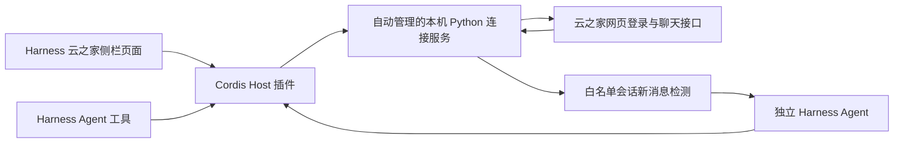

# DeepSeek Harness 插件

0.2.3 修复实际接收群聊 @ 消息时 `notifyTo` 被服务端省略的情况：当 `notifyType=1` 且 `desc` 包含 `type=at`、`data` 为本人 ID 的结构化记录时，也判定为明确 @ 本人。消息解析层会补齐省略的目标列表，使现有运行连接可以识别这类消息。不会只凭正文中的“@名字”触发；没有通知标志的转发旧 @、`at_all` 和其他人的 ID 均不会触发。

已用真实接收消息的元数据做修复前后识别对比，并以虚构 ID 的回归测试覆盖该字段结构。没有把真实聊天内容或账号 ID 写入源码或测试。实际模型生成及发送仍需由另一位群成员新发 @ 消息验证，历史消息不补回复。

0.2.2 补齐群聊 @ 身份匹配：`/api/me` 返回 `extId`，明确 @ 本人可匹配 `id`、`wbUserId`、`extId`，兼容字符串化的目标列表，并统一 ID 类型；本人发出的消息也按这三种身份排除。仅 @ 所有人或普通文本中的名字不触发。

自动回复配置分成全局设置、搜索添加会话、已配置会话。支持类型筛选、选中数量、启用/暂停/待保存标记和单独提示词；已配置名单不受搜索关键词隐藏，名称和群聊类型按账号保存在私密配置文件中，重启后仍可展示。

每个会话显示基线就绪、消息未触发、生成中、发送中、已回复或失败状态，配置页每 4 秒刷新诊断。一个失效会话不会阻断其他会话。诊断仅提供处理状态和时间，不包含聊天正文或模型响应；未设置 Harness 默认模型时明确提示配置模型。保存或重新登录后的首次读取只建立基线，请等待监控就绪后发送新的 @ 消息测试。

0.2.1 修复自动回复配置搜索和保存：输入关键词自动搜索，保留服务端别名匹配结果；保存新联系人时使用当前登录会话的已查询目标，并读取真实会话 ID 后持久化，避免把联系人 ID 当名称搜索。会话列表读取失败时保留已加载配置，仍可重新搜索和编辑。

若配置区显示 `Not found` 且保存按钮灰色，表示配置接口尚未加载，常见于进程仍使用旧版后端。升级后应完整重启 Harness 一次；仅刷新浏览器或禁用再启用插件可能仍复用旧模块。新版会对此给出明确提示。浏览器回归覆盖此错误状态、重新加载恢复，以及关键词与显示名称不同的搜索结果。

目标是官方 [DeepSeek Harness](https://github.com/deepseek-ai/deepseek-harness)，已验证 npm 版本 `0.2.1-alpha.2`。源码协议对照提交为 `d743267388641bc76f17c45ce8b4c231aed1d32c`。官方规范包括 [插件入门](https://github.com/deepseek-ai/deepseek-harness/blob/main/docs/user/develop/basic/index.md)、[打包安装](https://github.com/deepseek-ai/deepseek-harness/blob/main/docs/user/develop/basic/publish.md) 和 [工具定义](https://github.com/deepseek-ai/deepseek-harness/blob/main/docs/user/develop/basic/tool.md)。

## 架构



这次迁移采用 Host/Client 插件和已有协议核心组合，没有把 Python 网络/图片协议重新实现成 TypeScript。连接服务只监听随机回环端口，用随机密钥限制访问；浏览器只能通过受 Harness 鉴权保护的代理访问。云之家 Cookie、上游签名 URL 和内部密钥不会交给浏览器或 Agent。

Host 通过 `apply`、`inject`、Schemastery `Config`、`ctx.effect`、`ctx.tools.register(defineTool(...))`、`ctx.webServer.register` 接入。Client 通过 `main` 与 `sidebar.panellist` slot 接入，并使用官方模块工厂载体；`npm run build` 从 `client.mjs` 生成可直接安装的 `client.js`。包已包含生成文件，安装 tarball 不需要执行构建脚本。

## 安装与配置

0.2.0 起推荐登录后使用云之家页面左侧“消息”下方的“自动回复”模块配置。选择联系人或群聊，设置通用提示词和单独提示词，开启开关后点击“保存并应用”。单独提示词优先于通用提示词；留空时使用自然、简洁回复的默认要求。

群聊必须明确 @ 本人，@ 所有人不会触发。旧 YAML 中 `mentionOnly: false` 不再放宽群聊规则。高级配置支持检查间隔（1000–60000 毫秒）、回复超时（1000–600000 毫秒）、并发数（1–10）和工具白名单。模型使用新建 Agent 时的 Harness 默认模型。

提示词注册到该会话 Agent 的系统提示词段，聊天内容作为外部用户消息输入。保存配置会取消原有回复生成、清理 Agent 上下文，再建立新消息游标，不补发历史。Python 登录服务保持运行。

网页配置按云之家账号保存到 `${DSH_HOME:-~/.dsh}/yunzhijia/<安装目录及挂载路径哈希>.json`，权限为 0600。可用插件 `settingsPath` 指定绝对路径；同一源码目录运行多个 profile 时，请分别指定路径。该文件包含会话 ID 和提示词，不应提交公开仓库。网页保存值优先于 YAML 初始配置，未保存过的账号使用 YAML 初始配置。

`/api/auto-reply` 受 Harness 鉴权保护，POST 校验 Origin、账号、有效会话和大小，并串行执行保存。配置以临时文件原子替换。文件持久化、权限、HTTP 校验、群聊触发、真实 Harness 系统提示词隔离及浏览器配置操作均有测试；公开测试使用虚构数据和模拟模型；另已在本机验证一次真实群聊从他人 @、Agent 生成到成功发送的完整链路，真实聊天内容与账号信息不进入仓库。

先按 README 打包安装，再使用本机 profile 覆盖层配置同名 `yunzhijia` 行。覆盖会替换整份 config；没有填写的字段由 Config 默认值补齐：

```yaml
- id: yunzhijia
  config:
    python: python3
    proxy: ''
    mountPath: /plugins/yzj
    autoReply:
      enabled: true
      recipients:
        - '<从会话查询取得的会话ID>'
      mentionOnly: true
      pollIntervalMs: 4000
      replyTimeoutMs: 180000
      maxConcurrent: 2
      allowedTools: []
```

也可以把这份覆盖层保存在单独文件，通过 `dsh --profile yzj --patch /absolute/path/yzj-config.yml --no-open` 启动。请确认你的 Harness 版本仍使用同样的覆盖格式；可以运行 `dsh --profile yzj --patch ... --dump-config` 检查有效配置。实际会话 ID 和本机配置不要提交到公共仓库。

| 配置 | 默认值 | 说明 |
| --- | --- | --- |
| `python` | `python3` | Python 可执行文件；Windows 可改为 `python` |
| `proxy` | 空 | 直连；需要代理时填 `http://127.0.0.1:端口` |
| `mountPath` | `/plugins/yzj` | Harness 内的页面与接口挂载路径 |
| `startupTimeoutMs` | 15000 | 连接服务启动等待 |
| `requestTimeoutMs` | 60000 | 普通请求超时；SSE 使用独立连接生命周期 |
| `workspacePath` | 空 | 自动回复 Agent 的工作目录，空值使用启动目录 |
| `fileRoots` | `[]` | Agent 附件发送可额外读取的根目录；默认限制在当前工作目录 |
| `autoReply.enabled` | false | 开启自动接收与回复 |
| `autoReply.prompt` | 空 | 通用回复提示词 |
| `autoReply.recipientPrompts` | `{}` | 会话 ID 到单独提示词的映射；非空值优先于通用提示词 |
| `autoReply.recipients` | `[]` | 允许自动回复的精确会话 ID；开启时必须配置 |
| `autoReply.mentionOnly` | true | 群聊固定要求明确 @ 本人，@ 所有人不触发；单聊不要求 @ |
| `autoReply.pollIntervalMs` | 4000 | 后台消息校准间隔，最小 1000 |
| `autoReply.replyTimeoutMs` | 180000 | 单次模型回复截止时间 |
| `autoReply.maxConcurrent` | 2 | 同时处理会话数；每个会话串行 |
| `autoReply.allowedTools` | `[]` | 自动回复 Agent 可见/可执行的工具；默认只生成答复 |

聊天页面的实时 WebSocket/SSE 保留；后台自动回复通过游标轮询取新消息，页面关闭后仍工作。失去登录时停止处理，重新登录重新建立游标，不回放停机期间的历史。模型继承 Harness 当前默认选择，新建 Agent 时生效；已建 Agent 保留当时模型。

## Agent 工具

| 工具 | 行为 |
| --- | --- |
| `yunzhijia_status` | 登录状态、自动回复处理状态、页面位置 |
| `yunzhijia_conversations` | 会话列表或联系人/群组搜索 |
| `yunzhijia_history` | 指定会话消息及游标分页 |
| `yunzhijia_members` | 当前成员 |
| `yunzhijia_send_text` | 发送文字或 Markdown 原文 |
| `yunzhijia_send_image` | 上传并发送本地图片 |
| `yunzhijia_send_file` | 上传并发送本地普通附件 |
| `yunzhijia_receipt` | 核对不确定回执，不重发 |

发送工具需要稳定 UUID `clientMsgId`。同一请求 ID 只能对应同一内容和目标；超时/不确定时调用 receipt，不换 ID 自动重发。附件读取限制在工作目录及 fileRoots，并校验真实路径以防符号链接越界。工具调用遵循 Harness 工具执行与权限管线，UI 手工发送仍保留原有交互。

## 自动回复与数据边界

- 首次观察只记录最新游标，新消息进入后才触发；过滤自己发送、系统、撤回及重复消息。
- 白名单之外不触发；群聊必须明确 @ 本人，@ 所有人不触发；单聊在白名单内直接触发。
- 每个账号和会话有独立 Agent，回复串行；多会话遵守并发上限。
- 只回传最终文本，不发送思考内容或工具调用中间文本；Agent 报错、取消或登录账号改变时不回传旧答复。
- 超过 10000 个字符的答复会截断并附提示。发送回执不确定仅核对，不自动再次发送。
- 图片/文件/语音仅提供附件名称，没有自动视觉、语音识别或文件全文读取。不能宣称模型理解了未读取的附件。
- 自动回复内容会按 Harness 规则持久化，并传给其模型服务；云之家 Cookie 仍仅在连接服务内存中。截图和 @ 草稿的数据位置沿用 README。
- 自动回复的 Agent 默认无工具权限；如显式扩展 allowedTools，应理解这些工具会被所选会话的请求触发。
- 游标、去重和发送状态仅在进程内有效。插件卸载中止调度，清理 Agent 与连接服务；重启或重新登录重新建立基线。

## 验证

```sh
npm ci
npm run build
npm test
python3 -m unittest discover -s tests -v
npm pack --dry-run
```

测试覆盖受密钥保护的连接服务启动/退出、挂载路径适配、游标基线、重复与自己消息过滤、@ 条件、不确定回执避免重发及登录账号切换。`harness-runtime.test.mjs` 在临时 DSH_HOME 启动真实官方 Harness，通过模拟 LLM 验证 Agent 创建、消息投递、最终答复和清理；不连接云之家或真实模型。

真实官方 Web Harness 还通过浏览器检查了侧栏入口、内嵌登录页和未登录路由 401。完整聊天、截图、文件与 Markdown 的原有模拟验证继续保留。尚未对真实云之家账号执行自动回复验收。

## 0.1.1 修复

修复插件共享会话首次创建时被随机 ID 替换的问题：二维码创建、图片读取、扫码状态和后续聊天请求现在使用同一个内存会话。增加共享会话、独立网页 Cookie 及插件密钥校验的回归测试。

可选在线检查 `tests/browser-login.cjs` 在隔离的 Harness profile 中验证真实二维码图片解码；需要 Playwright，并通过 `DSH_TEST_URL` 提供该测试实例的登录 URL。不要将 URL、二维码或账号截图写入公开文档。检查不扫码，也不发送消息。

升级已运行的插件后，需要在 Harness 插件页禁用再启用云之家，以重建 Python 连接服务；刷新网页本身不会替换旧服务进程。

## 0.1.2 修复

显式保存并注销 WebServer 路由，以及工具和页面引导注册，修复插件禁用/启用、配置重载时的重复路由错误。清理可重复调用，启动中途失败也会回滚已有注册。新增真实 Cordis/Harness 重载测试。

若旧版已在当前 Harness 内存中留下路由，安装修复版后需要完整重启 Harness 一次才能清除旧记录。之后新版支持正常禁用、启用和热重载。

## 0.1.3 修复

修复网页 POST 请求转发时缺失 Content-Length 的问题。此前代理使用分块传输，而 Python 后端要求明确的请求长度，导致文字、图片和文件发送误报“请求大小超出限制”。现在代理在限定大小内读取请求并携带实际字节长度转发，保留 multipart 边界及二进制内容。文字请求最多 64 KiB，附件请求最多 32 MiB 加 64 KiB 表单开销；单个附件仍最多 32 MiB。

## 0.1.4 优化

首次进入云之家菜单时才加载聊天页面。聊天 iframe 由持续挂载的 `shell.overlay` 槽位持有，`main` 槽位只提供位置与尺寸；切换菜单只隐藏页面，保留会话列表、已加载消息、当前对话、滚动位置、草稿和待发送附件。回到菜单时增量同步消息与已读状态；离开时降低定时同步频率，并保留实时连接。页面刷新、插件卸载或重载会重新创建 iframe。聊天数据缓存仅保留在当前页面内存中，没有新增聊天记录的持久化存储。

可选浏览器回归检查 `tests/browser-menu.cjs` 使用隔离 Harness 的 `DSH_TEST_URL` 与 Playwright。它将聊天接口替换为虚构测试数据，验证三次菜单切换不重新加载页面、列表或初始消息记录，并保留滚动、草稿与附件，以及回到菜单后的新消息增量展示与调整窗口尺寸后的布局。测试不连接真实账号或发送消息。

## 0.1.5 修复与优化

历史消息优先使用官方消息的 `senderName` 展示发送人，兼容 `userName`、`fromUserName`、`fromPersonName` 与自己的账号名称。此前漏读 `senderName` 会将正常消息显示为“未知发送者”。文字及图片消息均有回归测试。

聊天图片、富文本内嵌图片、头像、引用图片和卡片图片使用页面内存中的 Blob 缓存；并发请求合并，切换对话时复用已加载的图片，懒加载继续生效。缓存最多 64 MiB / 128 项，5 分钟过期并按最近使用情况淘汰；单张超过 16 MiB 时使用原地址加载，不放入缓存。二维码、视频、下载和文档接口不使用此图片缓存。退出登录或登录过期时清空缓存并撤销 Blob URL；迟到的旧请求不会重新填入缓存。保持媒体接口的 `no-store`，不新增聊天图片的持久化存储。

浏览器回归使用虚构图片与两个测试会话，验证来回切换聊天只请求一次图片，且菜单切换仍保留草稿、附件和滚动位置。

## 0.2.4：会话标签与网络诊断

聊天列表为已保存且全局启用自动回复的联系人和群显示“已开启自动回复”。关闭总开关或移除会话后标签消失；页面登录时加载配置，定期同步其他页面的配置变化。

自动回复配置区区分读取连接失败、登录过期、超时和生成失败。已登录仅表示本地存在登录会话，不代表上游消息接口连通；网络失败不会进入 @ 判断。网络恢复后继续从原游标检查消息。过滤原因区分本人发送、撤回、系统消息和没有明确 @；保留最近成功回复时间，自己的回复回声不会覆盖成功状态。

需要代理的环境应在本机 web profile 的 `cordis.patch.yml` 中持久配置 `yunzhijia` 的 `proxy`（示例见上方安装配置），不能仅依赖某次启动的 `--patch` 参数。代理地址按本机实际端口填写；不要提交本机配置到公开仓库。
