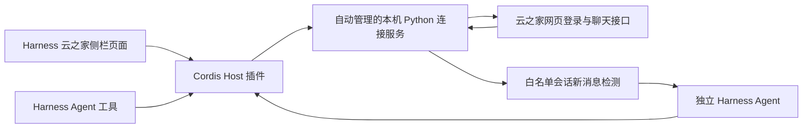

# DeepSeek Harness 插件

目标是官方 [DeepSeek Harness](https://github.com/deepseek-ai/deepseek-harness)，已验证 npm 版本 `0.2.1-alpha.2`。源码协议对照提交为 `d743267388641bc76f17c45ce8b4c231aed1d32c`。官方规范包括 [插件入门](https://github.com/deepseek-ai/deepseek-harness/blob/main/docs/user/develop/basic/index.md)、[打包安装](https://github.com/deepseek-ai/deepseek-harness/blob/main/docs/user/develop/basic/publish.md) 和 [工具定义](https://github.com/deepseek-ai/deepseek-harness/blob/main/docs/user/develop/basic/tool.md)。

## 架构



这次迁移采用 Host/Client 插件和已有协议核心组合，没有把 Python 网络/图片协议重新实现成 TypeScript。连接服务只监听随机回环端口，用随机密钥限制访问；浏览器只能通过受 Harness 鉴权保护的代理访问。云之家 Cookie、上游签名 URL 和内部密钥不会交给浏览器或 Agent。

Host 通过 `apply`、`inject`、Schemastery `Config`、`ctx.effect`、`ctx.tools.register(defineTool(...))`、`ctx.webServer.register` 接入。Client 通过 `main` 与 `sidebar.panellist` slot 接入，并使用官方模块工厂载体；`npm run build` 从 `client.mjs` 生成可直接安装的 `client.js`。包已包含生成文件，安装 tarball 不需要执行构建脚本。

## 安装与配置

先按 README 打包安装，再使用本机 profile 覆盖层配置同名 `yunzhijia` 行。覆盖会替换整份 config；没有填写的字段由 Config 默认值补齐：

```yaml
- id: yunzhijia
  config:
    python: python3
    proxy: ''
    mountPath: /plugins/yzj
    autoReply:
      enabled: true
      recipients:
        - '<从会话查询取得的会话ID>'
      mentionOnly: true
      pollIntervalMs: 4000
      replyTimeoutMs: 180000
      maxConcurrent: 2
      allowedTools: []
```

也可以把这份覆盖层保存在单独文件，通过 `dsh --profile yzj --patch /absolute/path/yzj-config.yml --no-open` 启动。请确认你的 Harness 版本仍使用同样的覆盖格式；可以运行 `dsh --profile yzj --patch ... --dump-config` 检查有效配置。实际会话 ID 和本机配置不要提交到公共仓库。

| 配置 | 默认值 | 说明 |
| --- | --- | --- |
| `python` | `python3` | Python 可执行文件；Windows 可改为 `python` |
| `proxy` | 空 | 直连；需要代理时填 `http://127.0.0.1:端口` |
| `mountPath` | `/plugins/yzj` | Harness 内的页面与接口挂载路径 |
| `startupTimeoutMs` | 15000 | 连接服务启动等待 |
| `requestTimeoutMs` | 60000 | 普通请求超时；SSE 使用独立连接生命周期 |
| `workspacePath` | 空 | 自动回复 Agent 的工作目录，空值使用启动目录 |
| `fileRoots` | `[]` | Agent 附件发送可额外读取的根目录；默认限制在当前工作目录 |
| `autoReply.enabled` | false | 开启自动接收与回复 |
| `autoReply.recipients` | `[]` | 允许自动回复的精确会话 ID；开启时必须配置 |
| `autoReply.mentionOnly` | true | 群聊仅处理当前账号被 @ 的消息；单聊不要求 @ |
| `autoReply.pollIntervalMs` | 4000 | 后台消息校准间隔，最小 1000 |
| `autoReply.replyTimeoutMs` | 180000 | 单次模型回复截止时间 |
| `autoReply.maxConcurrent` | 2 | 同时处理会话数；每个会话串行 |
| `autoReply.allowedTools` | `[]` | 自动回复 Agent 可见/可执行的工具；默认只生成答复 |

聊天页面的实时 WebSocket/SSE 保留；后台自动回复通过游标轮询取新消息，页面关闭后仍工作。失去登录时停止处理，重新登录重新建立游标，不回放停机期间的历史。模型继承 Harness 当前默认选择，新建 Agent 时生效；已建 Agent 保留当时模型。

## Agent 工具

| 工具 | 行为 |
| --- | --- |
| `yunzhijia_status` | 登录状态、自动回复处理状态、页面位置 |
| `yunzhijia_conversations` | 会话列表或联系人/群组搜索 |
| `yunzhijia_history` | 指定会话消息及游标分页 |
| `yunzhijia_members` | 当前成员 |
| `yunzhijia_send_text` | 发送文字或 Markdown 原文 |
| `yunzhijia_send_image` | 上传并发送本地图片 |
| `yunzhijia_send_file` | 上传并发送本地普通附件 |
| `yunzhijia_receipt` | 核对不确定回执，不重发 |

发送工具需要稳定 UUID `clientMsgId`。同一请求 ID 只能对应同一内容和目标；超时/不确定时调用 receipt，不换 ID 自动重发。附件读取限制在工作目录及 fileRoots，并校验真实路径以防符号链接越界。工具调用遵循 Harness 工具执行与权限管线，UI 手工发送仍保留原有交互。

## 自动回复与数据边界

- 首次观察只记录最新游标，新消息进入后才触发；过滤自己发送、系统、撤回及重复消息。
- 白名单之外不触发；群聊可要求 @，单聊在白名单内直接触发。
- 每个账号和会话有独立 Agent，回复串行；多会话遵守并发上限。
- 只回传最终文本，不发送思考内容或工具调用中间文本；Agent 报错、取消或登录账号改变时不回传旧答复。
- 超过 10000 个字符的答复会截断并附提示。发送回执不确定仅核对，不自动再次发送。
- 图片/文件/语音仅提供附件名称，没有自动视觉、语音识别或文件全文读取。不能宣称模型理解了未读取的附件。
- 自动回复内容会按 Harness 规则持久化，并传给其模型服务；云之家 Cookie 仍仅在连接服务内存中。截图和 @ 草稿的数据位置沿用 README。
- 自动回复的 Agent 默认无工具权限；如显式扩展 allowedTools，应理解这些工具会被所选会话的请求触发。
- 游标、去重和发送状态仅在进程内有效。插件卸载中止调度，清理 Agent 与连接服务；重启或重新登录重新建立基线。

## 验证

```sh
npm ci
npm run build
npm test
python3 -m unittest discover -s tests -v
npm pack --dry-run
```

测试覆盖受密钥保护的连接服务启动/退出、挂载路径适配、游标基线、重复与自己消息过滤、@ 条件、不确定回执避免重发及登录账号切换。`harness-runtime.test.mjs` 在临时 DSH_HOME 启动真实官方 Harness，通过模拟 LLM 验证 Agent 创建、消息投递、最终答复和清理；不连接云之家或真实模型。

真实官方 Web Harness 还通过浏览器检查了侧栏入口、内嵌登录页和未登录路由 401。完整聊天、截图、文件与 Markdown 的原有模拟验证继续保留。尚未对真实云之家账号执行自动回复验收。

## 0.1.1 修复

修复插件共享会话首次创建时被随机 ID 替换的问题：二维码创建、图片读取、扫码状态和后续聊天请求现在使用同一个内存会话。增加共享会话、独立网页 Cookie 及插件密钥校验的回归测试。

可选在线检查 `tests/browser-login.cjs` 在隔离的 Harness profile 中验证真实二维码图片解码；需要 Playwright，并通过 `DSH_TEST_URL` 提供该测试实例的登录 URL。不要将 URL、二维码或账号截图写入公开文档。检查不扫码，也不发送消息。

升级已运行的插件后，需要在 Harness 插件页禁用再启用云之家，以重建 Python 连接服务；刷新网页本身不会替换旧服务进程。
