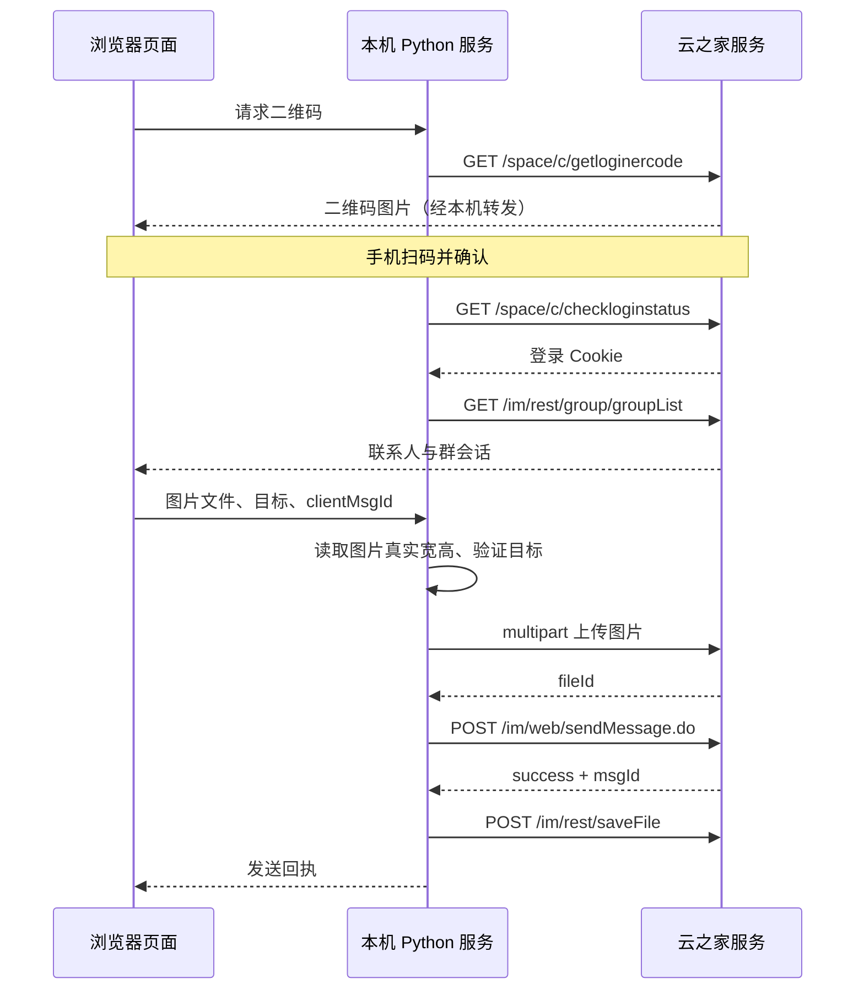

# 云之家个人账号消息发送：实现与证据

分析及验收日期：2026-10-13。对象为本机云之家 12.0.2 和官方网页版聊天资源 `20261008150054`。

## 核心结论

图片消息不是把图片字节放进消息内容，也不是使用旧枚举 `PICTURE=4`。当前观察到的路径是：**图片上传取得 `fileId` → 用附件消息 `msgType=8` 引用这个文件 → 服务端返回消息 ID**。`param.ftype` 区分普通文件、图片、GIF 表情。

桌面端和网页端共享这个消息结构，但连接和认证不同。桌面端通过 JSBridge/IPC 交给原生层；本项目直接调用当前网页版 HTTP 接口，不依赖桌面客户端、不修改客户端安装包、不读取其登录数据。



## 网页认证

当前官方入口：<https://www.yunzhijia.com/im/xiaoxi/>。旧 `/im/` 入口在本次有效网页登录会话中返回 404，不能把这个结果当作网页版整体不可用。

官方登录页脚本加载 `frame/login.min.js`。SDK 的 `QRCode`：

1. `GET /space/c/getloginercode?time=<毫秒时间>`，返回 `data.url` 与 `data.token`。
2. 网页显示 `data.url` 的二维码。
3. 官方 SDK 原本监听 `/space/qrloginsocket?token=...`，成功后请求 `/space/c/checkloginstatus`。本项目采用有界间隔轮询，保留同一个服务端 CookieJar。
4. `checkloginstatus` 建立网页登录 Cookie，上传代码读取名为 `at` 的 Cookie。登录 token 后续可能不再返回成功，因此本项目用实际会话列表请求验证已有 Cookie，避免把已登录会话错判为未登录。

本项目不提供密码收集页面，登录数据不写到浏览器 localStorage、日志或磁盘。

## 主要接口

| 用途 | 请求及参数 | 来源 |
|---|---|---|
| 会话列表 | `GET /im/rest/group/groupList?offset=0&count=200`，响应 `data.list` | 网页 `SessionList._initSlCollection` |
| 通讯录搜索 | `POST /gateway/openorg/v2/contacts/searchPersonsInfo`，表单 `word,page,pageSize` | 网页 `searchPerson → re(...,4)` |
| 群组搜索 | `GET /im/rest/search/groupByName`，`word,count,page` | 网页 `searchGroup → re(...,2)` |
| 团队上传域名 | `POST /gateway/opencloud/params/acqParm2Gen`，`eid,field=all`；取 `data.domains.xuntong.upload` | 网页应用配置模块 |
| 图片上传 | `POST /docrest/doc/file/uploadfile?t=<时间>`；`multipart/form-data` | 网页 HTML5Uploader |
| 文件信息 | `GET /im/rest/fileInfo?fileId=...`，返回 `fileInfo` | 官方网页上传完成处理 |
| 消息发送 | `POST /im/web/sendMessage.do`，URL 编码表单 | 网页发送模块 |
| 群文件登记 | `POST /im/rest/saveFile`，`fileId,threadId,isEncrypted=false,uploadFileMode=1` | 网页 `onSendSuccess` |
| 消息列表/核对回执 | `POST /im/rest/message/listMessage`，`groupId,userId,type=new,count,msgId` | 网页聊天列表模块 |

普通会话通过 `groupId` 定位，包括已有单聊。新联系人通过 `toUserId` 定位，服务端可在发送时返回实际会话 ID。文件传输助手的固定 userId 从官方网页常量中读取。

旧发送入口的目标查询最多读取 2000 个条目；当前聊天界面完整分页同步内部和外部会话，不再受此展示上限限制。搜索最多请求 30 个联系人/群组结果。后端只接受当前登录会话已经从上游取得的目标 ID。

## 图片上传

官方网页发送框分包 `3.ebb9b1de3fbe9d8e3d5d.js` 中，普通 HTML5 上传请求明确执行：

```js
const form = new FormData();
form.append('fileToUpload', file, filename);
form.append('bizkey', 'xuntong');
form.append('auth_token', jQuery.cookie('at') || '');
// POST <fileUploadServer>/docrest/doc/file/uploadfile?t=<时间>
// xhr.withCredentials = true
// fileId = response.data[0].fileId
```

域名可能由团队配置指定。不能把轻应用使用的 `ticket/appId` 上传协议直接套到个人聊天。桌面 renderer 的请求封装还出现 `appkey/signature/openToken`，同样不能推断网页需要沿用它们。

本项目将图片字节在服务内存中组装成相同的 multipart 请求，同时使用登录 Cookie。成功后再发送消息。上传失败时不调用消息发送接口。重试已知失败的消息时复用已上传的文件 ID。

## 图片消息结构

消息请求为 URL 编码表单，`param` 字段是 JSON 字符串：

```json
{
  "clientMsgId": "随机 UUID",
  "groupId": "目标会话 ID，或空字符串",
  "toUserId": "联系人 ID，或空字符串",
  "msgType": 8,
  "content": "[图片]",
  "msgLen": 4,
  "param": {
    "file_id": "上传返回的 fileId",
    "name": "sample.png",
    "size": 10240,
    "ext": "png",
    "ftype": 1,
    "unreadMonitor": 0,
    "picWidth": 360,
    "picHeight": 220
  }
}
```

上面的 `size` 是示例值。实际上由文件字节长度取得，宽高由后端解析文件取得。`msgLen` 使用 JavaScript 的 UTF-16 code unit 长度，以正确处理 emoji。

| 参数 | 意义 |
|---|---|
| `msgType=2` | 文字 |
| `msgType=8` | 附件；当前图片使用此类型 |
| `ftype=0` | 普通文件 |
| `ftype=1` | 图片 |
| `ftype=2` | GIF/表情附件 |
| `msgType=23` | 富文本；文字中图片通过 `param.desc` 引用，本项目未实现混排富文本 |

官方网页在上传后调用 `fileInfo` 获取元数据再发消息。本项目已经持有文件名、长度与解析所得的尺寸，因此直接组装同样的消息结构。这是实现选择，而非声称客户端省略了 `fileInfo`。

发送成功后，官方网页调用 `saveFile` 登记会话文件。这个操作失败不意味着消息发送失败；本项目显示“消息已发送，但群文件列表登记未成功/未确认”，不会因此重发消息。

## 桌面端图片规则与原生边界

安装包 renderer `dashboard.js` 的模块 59033 构造 `msgType=8`、空 `file_id` 及 `picWidth/picHeight`。模块 61683 定义 `FILE=0, IMAGE=1, EMOJI=2`；模块 4927 定义 8 MiB 和 5000 像素阈值。GIF 优先走表情，普通图片小于两个阈值才按图片，否则按文件。

随后上传逻辑先把 `fileId` 写回 `param.file_id`，再交给模块 36678 补齐内容、`msgLen` 和 `clientMsgId`。发送通过 `system:im:message:send:event` 进入 JSBridge。上传通过 `system:transfer:upload` 和 `system:transfer:action` 启动任务，等待 `completed/error/abort`。

主进程与 preload 使用 `@cloudhub/encrypt.Load(...)` 加载。本次没有解密这些程序，也没有用原生运行证据观察桌面端最终网络传输。因此桌面端底层网络、加密或长连接实现仍未知，不能把 renderer 的桥接链路描述成已确认的底层发送协议。

**网页版普通上传代码未观察到桌面端相同的 8 MiB/5000 像素分流条件。** 本项目沿用这条保守规则是设计选择，界面提前提示“将作为文件发送”。没有对图片自动压缩，也没有使用大文件分片协议。

## 回执与重复发送保护

每张图片拥有稳定的 `clientMsgId`。后端记录 payload 摘要、目标、文件 ID 和状态。同一个 ID 用于不同内容会被拒绝；已确认成功的重复请求返回已有回执。

消息请求遇到传输异常、非 JSON 响应或缺少 `msgId` 时，结果视为不确定。后续操作只查询最近 100 条消息中的 `clientMsgId`，不自动重发。找不到匹配回执仅表示尚不能确认，并非证明消息没有送达。这种内存记录随进程退出而消失，不是跨服务重启的持久幂等保证。

## 观察与覆盖边界

协议说明根据云之家 12.0.2 renderer 与官方网页资源的静态观察整理。公开源码仅保留本项目实现和协议说明，不分发原始安装包、厂商源码摘录、下载的网页 bundle 或本地分析记录。读者可通过 [官方网页入口](https://www.yunzhijia.com/im/xiaoxi/) 核对当前资源；本文描述的资源版本不保证长期可用。

接口、字段和桌面桥接边界来自静态观察；PNG 上传和消息回执另经在线检查。未在线覆盖 GIF、BMP、大图片文件分流、禁言群、跨企业账号或所有异常网络情况。

离线发送测试覆盖上传失败不发消息、上传/发送/登记顺序、真实宽高、成功重放、发送超时避免重发、目标校验、文件类型校验、请求 ID 内容绑定、UTF-16 长度和域名限制。完整测试命令见 [README](../README.md)。
